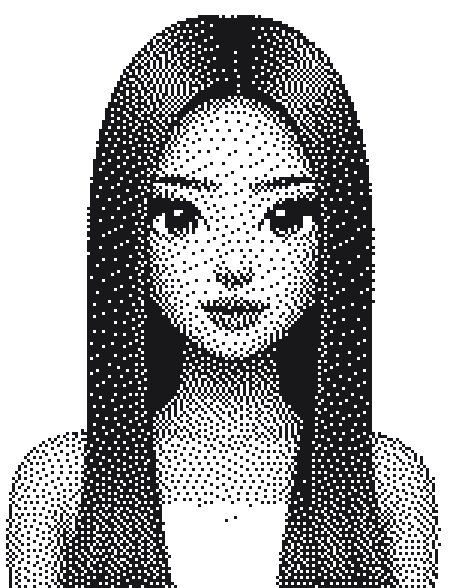

  

<h2 align="center">Hi 👋, I’m Olha</h2>

  <b>Full-Stack &amp; Mobile Developer</b> 
  <code>just ship it, beautifully</code> 
   
  Building cross-platform apps and the reliable systems behind them.

<h2 align="center">🚀 About Me</h2>

<picture>
  <source media="(prefers-color-scheme: dark)" srcset="./assets/portrait-dark.png" />
  <source media="(prefers-color-scheme: light)" srcset="./assets/portrait-light.png" />
  
</picture>

**Olha**, here — a Computer Science student from Ukraine 🇺🇦 who builds complete products, from the first Figma frame to the database behind it.

I build cross-platform apps with **React Native & Expo**, web products with **React, Next.js & Tailwind**, and APIs with **NestJS, FastAPI & Express** on **PostgreSQL / Supabase**.

Right now I’m deepening my backend craft — real-time features with **Socket.IO**, clean data models with **Prisma**, and shipping with **Docker**.

My goal is simple: calm interfaces, clear user flows, and code that stays easy to change. Open to **internships & product work**.

 

<h2 align="center">🗂 Featured Projects</h2>

| Project | What it is | Stack |
| :-- | :-- | :-- |
| 🧠 [**Living Mind Map**](https://github.com/oljyaaa/kai_labs) | Real-time social map of thoughts: live feed, chats and a world map of all 250 countries | Next.js · NestJS · Prisma · PostgreSQL · Socket.IO |
| 📅 [**Daybook**](https://github.com/oljyaaa/planner-Plan_My_Day) | Mobile planner & day journal: schedule, workload and personal finances | React Native · Expo · Supabase |
| 💅 [**BeautyRoom**](https://github.com/oljyaaa/BeautyRoomApp) | Booking journal for a cosmetology studio with reminders and PDF export (diploma) | Expo Router · TypeScript · Jest |
| 🏙️ [**Crimson CRM**](https://github.com/oljyaaa/luxe-casa-crm) | Real-estate agency CRM: clients, properties, calendar and analytics | React · TypeScript · shadcn/ui |
| ⚡ [**SkillForge API**](https://github.com/oljyaaa/skillforge-api) | FastAPI service for SkillForge web and mobile clients | Python · FastAPI · Docker |

<h2 align="center">🤝 Connect</h2>

  &nbsp;
  &nbsp;
  &nbsp;
  

<h2 align="center">💻 Tech Stack</h2>

   
   
   
   
  + React Native · Expo · Reanimated · shadcn/ui · Socket.IO · Zod · Pydantic · Playwright · Jira · Xcode

<h2 align="center">📊 GitHub Stats</h2>

  

<h2 align="center">🐍 Contribution Snake</h2>

<picture>
  <source media="(prefers-color-scheme: dark)" srcset="https://raw.githubusercontent.com/oljyaaa/oljyaaa/output/github-contribution-grid-snake-dark.svg" />
  <source media="(prefers-color-scheme: light)" srcset="https://raw.githubusercontent.com/oljyaaa/oljyaaa/output/github-contribution-grid-snake.svg" />
  
</picture>

<code>olha@github ~ % exit</code> · made in Ukraine 🇺🇦

